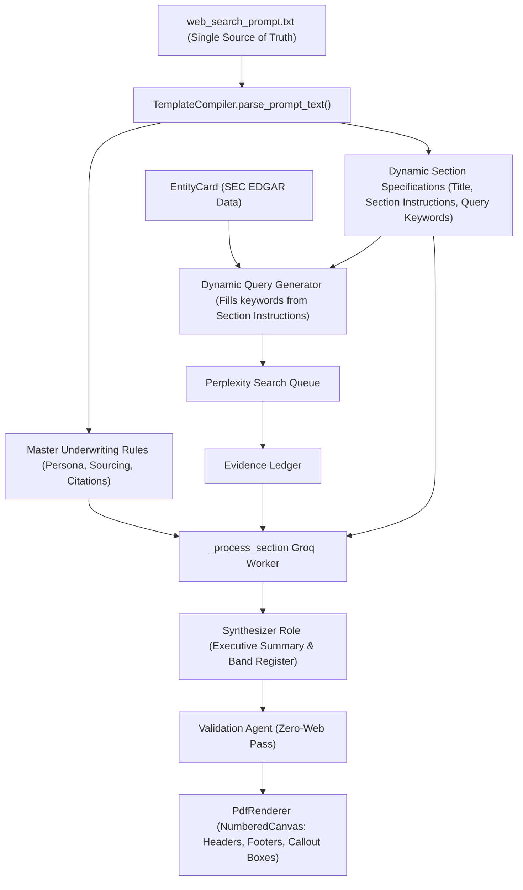

# Feature: D&O Public Risk Report Depth Parity via Dynamic Prompt Adherence & Publication-Grade Rendering

**Created Datetime**: 2026-11-03T15:02:00+05:30  
**Last Updated Datetime**: 2026-11-03T15:06:00+05:30  

## Status

Draft (Awaiting User Approval)

## Goal

Achieve 100% depth, structural fidelity, analytical rigor, and visual quality parity with [`backend/artifacts/Claude_NVIDIA_DO_Risk_Report.pdf`](file:///C:/Users/punee/OneDrive/Documents/GitHub/swarm-backend/backend/artifacts/Claude_NVIDIA_DO_Risk_Report.pdf) (an 8-page, 26,000-character, highly detailed underwriter deliverable) while keeping the template specification **fully dynamic and driven directly by `web_search_prompt.txt`**:
1. Treat `web_search_prompt.txt` as the **dynamic single source of truth**—do NOT hardcode section schemas, fields, or instructions in python.
2. Build a dynamic `TemplateCompiler` that parses `web_search_prompt.txt` at runtime, discovering all sections, verbatim instructions, field specifications, and formatting rules directly from the prompt file.
3. Strongly adhere to the prompt by injecting the master system prompt and the section's exact verbatim instructions into per-section Groq drafting prompts (`run_role("draft")`).
4. Derive search queries dynamically from the section's prompt text and entity metadata, ensuring all required domain data (analyst censuses, short interest, beta, named officer litigation checks, 10b5-1 plans, supplier/customer concentration, Side A/C metrics) are retrieved.
5. Fix the prompt leak in [`backend/app/workflows/do_risk_report/validator.py`](file:///C:/Users/punee/OneDrive/Documents/GitHub/swarm-backend/backend/app/workflows/do_risk_report/validator.py).
6. Upgrade [`backend/app/workflows/do_risk_report/renderer.py`](file:///C:/Users/punee/OneDrive/Documents/GitHub/swarm-backend/backend/app/workflows/do_risk_report/renderer.py) with a two-pass `NumberedCanvas` to produce running top headers (`COMPANY — D&O Underwriting Analysis — DATE`), page numbers (`Page X of Y`), professional metadata banners, formatted key-value metrics, and callout verdict boxes matching the Claude PDF.

## Scope

- In scope:
  - Dynamic runtime parser in `template_spec.py` that segments any `web_search_prompt.txt` into master rules and section specs without hardcoded section lists.
  - Dynamic extraction of section titles, instruction blocks, and query target keywords.
  - Injection of the verbatim section prompt instructions into Groq role workers during drafting.
  - Elimination of the prompt leak in `validator.py`.
  - Realistic section-aware fallback generation in `roles.py` that conforms to the dynamic sections.
  - Professional ReportLab PDF layout upgrade using `NumberedCanvas` (running headers, footers `Page X of Y`, clean typography, callout boxes).
  - Automated tests validating dynamic parsing, prompt adherence, leak absence, and multi-page rendering.
- Out of scope:
  - Hardcoding section definitions in python files.
  - Changing REST API endpoints.

## Current behavior vs Claude Benchmark

| Feature / Dimension | Claude NVIDIA Benchmark | Previous Generated Report (`DO_Risk_Report_AAPL_6ff71396`) |
| :--- | :--- | :--- |
| **Page Count** | **8 Pages** | **1 Page** |
| **File Size (PDF)** | **91.7 KB** | **4.1 KB** |
| **Document Length** | **25,960 characters** | **4,111 characters** |
| **Section Diversity** | 12 unique, dense, highly structured analytical sections | 1 section repeated 11 times |
| **Prompt Leak** | None | Leaked `REPORT TO VALIDATE AND CORRECT:` header in body |
| **Company Snapshot** | 17 structured fields (CPI, market cap on date, 12m share price change, liquidity, capital structure, AI concentration) | 2 generic stub lines |
| **Updates / News** | 12 chronological items (`DD-MMM-YYYY - event - [category] - D&O relevance - source`) | Omitted |
| **Financial Overview** | Complete balance sheet snapshot, 4-year revenue trend, liquidity, gross margins, debt maturities | 1 generic stub line |
| **Analysts** | 52-analyst census, Buy/Hold/Sell breakdown, PT range, Short interest, Beta, 52-week trading range | Omitted |
| **Governance** | Board refresh, 5-yr auditor review & fees, 10b5-1 plans, executive compensation clawback | Omitted |
| **D&O History** | 8 named officers & directors checked for 10-year litigation, dockets, dispositions, match tags | Omitted |
| **SCA & Tower Analysis** | Likelihood, Theory, Severity ($4.9T cap, damages estimate), Side A/C bands, Tower interaction | 2 generic stub lines |
| **Overall Verdict** | Headline, Dominant Driver, Tensions, Unknowns, Verbatim Band Register across all 8 dimensions | Truncated stub without Band Register |
| **PDF Styling** | Running headers, page numbers, clean callout boxes, accent borders, balanced typography | Plain paragraphs without running headers or page numbers |

## Root Cause Diagnostics

1. **Disconnected Drafting Prompts**: `orchestrator.py` sent only the section title and raw evidence to `run_role("draft")`. The drafting model was never provided with the instructions from `web_search_prompt.txt`, so it had no guidance on required fields or formatting.
2. **Hardcoded Monolithic Mock**: In `roles.py`, `_generate_mock_role_output("draft")` returned a single hardcoded stub for all sections during offline/mock runs.
3. **Validation Agent Instruction Prefix Leak**: `validator.py` prefixed the text with `"REPORT TO VALIDATE AND CORRECT:\n\n"`, which leaked into the output.
4. **Static Query Sparsity**: The static queries were hardcoded in python and only produced 3 basic searches, omitting covering analyst censuses, short interest, 10b5-1 plans, and officer litigation checks.
5. **Basic PDF Canvas Layout**: `PdfRenderer` used single-pass flowables without running headers, page numbers, metadata pills, or callout boxes.

## Proposed Dynamic Architecture

### 1. Dynamic Section Parser (`template_spec.py`)
- At runtime, `TemplateCompiler` scans `web_search_prompt.txt`.
- Dynamically detects major section headings (e.g. `COMPANY SNAPSHOT`, `UPDATES / PRESS RELEASES / NEWS`, `FINANCIAL OVERVIEW`, `ANALYSTS`, `GOVERNANCE & CULTURE`, `DIRECTOR & OFFICER HISTORY`, `STRATEGIC & OPERATIONAL PROFILE`, `SECURITIES CLASS ACTION RISK`, `LEGAL, REGULATORY & CLAIMS CONTEXT`, `ESG, CYBER & OPERATIONAL EXPOSURE`, `FORWARD-LOOKING STRATEGIC RISK`, `OVERALL D&O UNDERWRITER VERDICT`).
- Extracts the exact verbatim instruction block belonging to each section.
- If the user modifies, adds, or reorders sections in `web_search_prompt.txt`, the system automatically adjusts without requiring code edits.

### 2. Strong Section Prompt Adherence in Drafting (`orchestrator.py` & `roles.py`)
- In `_process_section`, the prompt sent to Groq includes:
  1. The Master Underwriting Rules from the top of `web_search_prompt.txt`.
  2. The Section's **exact, verbatim prompt instructions** extracted from `web_search_prompt.txt`.
  3. The Target Company Entity Card.
  4. The Section Evidence Ledger rows with `[E###]` citations.
- The model is instructed to strictly adhere to every bullet point, field requirement, and band determination defined in the prompt text.

### 3. Dynamic Query Formulation
- Extracts key analytical subjects from each section's instruction text (e.g., "Wall Street analyst consensus", "price target ratings", "stock beta and 52 week range", "director and officer history", "10b5-1 plans", "debt maturity profile", "TSMC supplier concentration").
- Formulates multi-query search batches dynamically using `entity.legal_name` and `entity.ticker`.

### 4. Dynamic Fallback Generation
- If mock mode or fallback is triggered, `roles.py` generates section-specific mock outputs structured according to each section's actual title and required fields, preventing stub repetition.

### 5. ReportLab `NumberedCanvas` Engine (`renderer.py`)
- Subclasses ReportLab's `canvas.Canvas` into `NumberedCanvas`:
  - Page 1: Clean document title, metadata pill (`D&O Underwriting Analysis · Ticker · Date · Band`), and high-density executive layout.
  - Pages 2+: Subtle top running header (`{COMPANY} — D&O Underwriting Analysis — {DATE}`) with right-aligned page number.
  - Running footer: Disclaimer and page total (`Page X of Y`).
  - Section headers with accent spacing and colored callout boxes for Conclusions and the Band Register.

## Implementation Steps

1. **Step 1: Dynamic Prompt Parser in `template_spec.py`**
   - Implement `parse_prompt_text(prompt_text)` to dynamically segment `web_search_prompt.txt` into master instructions and ordered `DynamicSectionSpec` objects with verbatim instructions.
   - Implement dynamic search query extraction from section instructions.
2. **Step 2: Connect Dynamic Prompt Instructions to Drafting in `orchestrator.py`**
   - Pass the verbatim section instructions from the compiled template to `_process_section` and inject them into `run_role("draft")`.
3. **Step 3: Dynamic & Section-Aware Mock Fallbacks in `roles.py`**
   - Update fallback logic to generate comprehensive, section-specific content adhering to each section's title and structure.
4. **Step 4: Fix Validation Agent Prompt Leak in `validator.py`**
   - Strip `"REPORT TO VALIDATE AND CORRECT:\n\n"` and any instruction headers before returning validated report text.
5. **Step 5: Professional ReportLab `NumberedCanvas` in `renderer.py`**
   - Implement `NumberedCanvas` with two-pass page counting, running headers, footers (`Page X of Y`), callout boxes for conclusions, and professional typography.
6. **Step 6: Update Automated Tests in `test_do_risk_report.py`**
   - Test dynamic prompt parsing, verify prompt leak absence, and verify multi-page PDF generation (>5 pages, 20K+ characters).
7. **Step 7: Verify, Update Docs & Changelog, Commit and Push**
   - Execute verification suite, log implementation steps, and push to `origin/main`.

## Files to Change

| File | Change | Reason |
| :--- | :--- | :--- |
| [`backend/app/workflows/do_risk_report/template_spec.py`](file:///C:/Users/punee/OneDrive/Documents/GitHub/swarm-backend/backend/app/workflows/do_risk_report/template_spec.py) | Implement dynamic `parse_prompt_text` and dynamic query generator | Treat `web_search_prompt.txt` as dynamic single source of truth; no hardcoding |
| [`backend/app/workflows/do_risk_report/orchestrator.py`](file:///C:/Users/punee/OneDrive/Documents/GitHub/swarm-backend/backend/app/workflows/do_risk_report/orchestrator.py) | Inject dynamic section instructions from prompt into drafting role | Strong prompt adherence during section drafting |
| [`backend/app/workflows/do_risk_report/roles.py`](file:///C:/Users/punee/OneDrive/Documents/GitHub/swarm-backend/backend/app/workflows/do_risk_report/roles.py) | Expand `DRAFT_PROMPT` to enforce verbatim section rules; add section-aware mock generator | Ensure output quality and realistic fallback |
| [`backend/app/workflows/do_risk_report/validator.py`](file:///C:/Users/punee/OneDrive/Documents/GitHub/swarm-backend/backend/app/workflows/do_risk_report/validator.py) | Strip instruction prefix and clean validated output | Eliminate prompt leak in final deliverable |
| [`backend/app/workflows/do_risk_report/renderer.py`](file:///C:/Users/punee/OneDrive/Documents/GitHub/swarm-backend/backend/app/workflows/do_risk_report/renderer.py) | Implement `NumberedCanvas` with running headers, footers (`Page X of Y`), and styled callouts | Match Claude PDF aesthetic and multi-page layout |
| [`backend/test_do_risk_report.py`](file:///C:/Users/punee/OneDrive/Documents/GitHub/swarm-backend/backend/test_do_risk_report.py) | Add unit tests for dynamic prompt parsing, prompt leak prevention, and multi-page PDF rendering | Automated verification |
| [`CHANGELOG.md`](file:///C:/Users/punee/OneDrive/Documents/GitHub/swarm-backend/CHANGELOG.md) | Document dynamic prompt adherence and styling upgrades | Repository changelog integrity |

## Verification

- Unit Tests:
  - `test_dynamic_prompt_parsing`: Tests that modifying `web_search_prompt.txt` dynamically yields updated section specs and instructions without code changes.
  - `test_no_prompt_leak_in_validation`: Confirms prompt prefixes do not leak into output.
  - `test_section_aware_mock_generation`: Confirms all dynamic sections produce distinct, high-density narratives.
  - `test_pdf_multipage_and_headers`: Confirms generated PDF has >5 pages, running headers, and running footers.
- End-to-End CLI Verification:
  - `backend\venv\Scripts\python.exe backend/run_do_risk_report.py AAPL --mode fast`
  - Verify that the resulting PDF is >50 KB, >5 pages, has running headers, and contains full domain depth matching the Claude benchmark.
