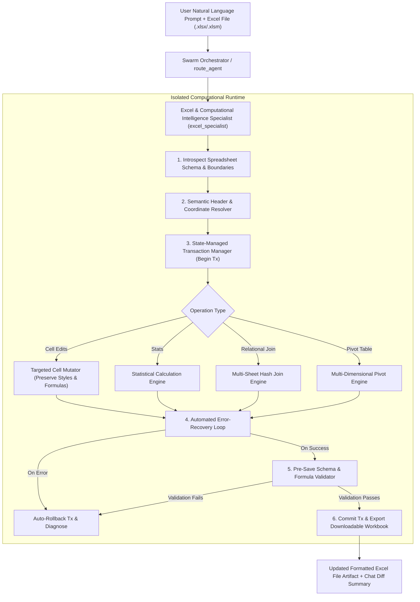

# Feature: Enterprise Excel & Computational Intelligence Agent (`excel_specialist`)

**Datetime**: `2026-11-02T16:18:00+05:30`  
**Status**: Draft  

---

## Goal

Create an enterprise-grade Excel and Computational Intelligence specialist agent (`excel_specialist`) that:
1. Natively translates natural language requests into precise spreadsheet coordinates, structural ranges, and column headers without requiring explicit technical cell coordinates (e.g. `A1:B10`) from users.
2. Performs targeted cell-level modifications that preserve 100% of existing workbook formatting (fonts, fills, borders, number formats, alignments), formulas, VBA macros (`keep_vba=True`), and workbook metadata.
3. Executes high-performance statistical calculations, multi-sheet relational joins (inner, left, right, full outer), and multi-dimensional pivoting.
4. Executes all computational scripts in a secure, isolated runtime environment protected by an automated error-recovery loop, a state-managed transaction log with multi-step rollbacks, and pre-save schema validation to guarantee zero file corruption.
5. Seamlessly integrates into Swarm backend routing, on-the-fly workflow orchestration, and frontend agent selector and inspector modals.

---

## Scope

### In Scope
- **Agent Package Architecture (`backend/app/agents/excel_specialist/`)**:
  - `config.json`: Agent definition with model `qwen-3.8`/`gemini-3.8-flash`, temperature `0.1` for deterministic precision, Lucide `FileSpreadsheet` icon.
  - `prompt.md`: Comprehensive enterprise system prompt defining coordinate resolution protocols, data integrity rules, formatting preservation standards, and error-recovery behaviors.
  - `skills.json`: 6 enterprise skills (`coordinate_resolution`, `format_preserving_edits`, `statistical_computing`, `relational_sheet_joins`, `multidimensional_pivoting`, `transaction_rollback_and_validation`).
  - `tools.py`: Complete suite of 8 high-performance Python tools and handlers with transactional safety.
  - `mcp.json`: Standard modular MCP server declarations.
- **Computational Intelligence Engine**:
  - Semantic Header & Table Resolver: Automatically inspects sheets, detects table boundaries, header rows, data types, and matches colloquial or partial column names.
  - Natural Language Coordinate Mapper: Translates fuzzy concepts ("APAC Q4 revenue", "total sales column", "last 5 rows") into exact cell coordinates (`Sheet1!E14`, `D2:D105`).
  - Targeted Cell Mutator: Preserves cell styles, fonts, borders, fills, number formats, and formula chains during updates.
  - Statistical Computing Engine: Summary metrics, rolling averages, percentiles, variances, z-scores, correlations.
  - Relational Multi-Sheet Join Engine: In-memory hash joins across sheets with key matching and schema alignment.
  - Multi-Dimensional Pivoting Engine: Dynamic multi-axis pivot tables with hierarchical headers, aggregations, and grand totals.
- **Transactional Safety & Validation Engine**:
  - Transaction Log: Records transaction IDs, mutated cell coordinates, before/after values, and formatting snapshots.
  - Multi-Step Rollback: Allows rolling back 1 or more transactions or reverting to session checkpoints.
  - Pre-Save Schema & Formula Validator: Enforces XML structure validity, formula syntax balance, coordinate bounds, and sheet naming rules before committing edits.
  - Automated Error-Recovery Loop: Catches runtime mutation exceptions, triggers immediate partial-rollback, logs diagnostic trace, and attempts self-correcting fallbacks.
  - Isolated Sandboxed Runtime: Strictly restricts execution scope for formulas and computational scripts (no unsafe system builtins).
- **Orchestration & Workflow Integration**:
  - Register `excel_specialist` in `backend/app/main.py` routing.
  - Update `synthesize_on_the_fly_workflow` and `generate_workflow_spec` in `backend/app/ai_generator.py` to route complex Excel tasks, cell updates, multi-sheet joins, and pivot requests to `excel_specialist`.
  - Update frontend UI (`AgentCard.tsx`, `AgentDetailsModal.tsx`) with `FileSpreadsheet` avatar and live execution support.
- **Automated Verification**:
  - Dedicated test suite `backend/test_excel_specialist.py` verifying coordinate resolution, format preservation, joins, pivots, rollback, error recovery, and pre-save validation.

### Out of Scope
- Direct COM interop with Microsoft Excel desktop application (runs server-side in Linux/Windows via pure Python `openpyxl`).
- Re-calculating complex proprietary proprietary VBA macro runtime execution (macros are preserved, not executed).

---

## Current Behavior

- Excel file handling is split between `file_creator` (which generates simple spreadsheets or raw CSVs from text) and `file_parser` (which extracts preview text from `.xlsx` files).
- When a user uploads an existing Excel spreadsheet and asks to update specific data (e.g. "update last quarter's revenue for EMEA to $1.2M", "join the Customers and Orders sheets", or "pivot sales by region"), the current system lacks:
  1. Semantic natural language coordinate resolution to locate exact cell intersections (`Sheet1!E14`).
  2. Targeted cell-level mutation with style/formatting preservation (previous generation tools overwrite entire worksheets, losing existing formulas, conditional formatting, fonts, and borders).
  3. Relational multi-sheet joins and multi-dimensional pivot table generation.
  4. Transaction rollback logs and pre-save schema validation to prevent workbook corruption.

---

## Proposed Architecture & Workflow



---

## Files to Change & Create

| File | Change | Reason |
| :--- | :--- | :--- |
| `backend/app/agents/excel_specialist/config.json` | **[NEW]** | Agent manifest defining ID, name, role, model, icon (`FileSpreadsheet`), and description |
| `backend/app/agents/excel_specialist/prompt.md` | **[NEW]** | Enterprise computational intelligence persona, coordinate resolution, and formatting directives |
| `backend/app/agents/excel_specialist/skills.json` | **[NEW]** | 6 specialized skills (coordinate resolution, joins, pivots, formatting preservation, rollback) |
| `backend/app/agents/excel_specialist/mcp.json` | **[NEW]** | Modular MCP configuration |
| `backend/app/agents/excel_specialist/tools.py` | **[NEW]** | 8 high-performance Python tools: introspection, coordinate resolution, targeted edits, joins, pivots, stats, rollback, validation |
| `backend/app/main.py` | **[MODIFY]** | Support explicit targeting of `excel_specialist` and update agent list summaries |
| `backend/app/ai_generator.py` | **[MODIFY]** | Add `excel_specialist` to workflow generator roster and synthesize pipelines for complex Excel tasks |
| `frontend/src/app/agents/components/AgentCard.tsx` | **[MODIFY]** | Render `FileSpreadsheet` icon for `excel_specialist` |
| `frontend/src/app/chat/components/AgentDetailsModal.tsx` | **[MODIFY]** | Render `FileSpreadsheet` icon and live execution support for `excel_specialist` |
| `backend/test_excel_specialist.py` | **[NEW]** | Comprehensive automated test suite verifying all 8 computational tools, joins, pivots, rollbacks, and error recovery |

---

## Detailed Component Specifications

### 1. Tools Implementation (`backend/app/agents/excel_specialist/tools.py`)
- `introspect_spreadsheet`: Scans workbook sheets, dimensions, header rows, column data types, table structures, and formula cell maps.
- `resolve_coordinates`: Converts natural language references ("revenue column", "APAC in 2025", "last row of totals") into concrete cell/range coordinates (`Sheet1!C4:C28`, `Sheet1!E14`).
- `edit_spreadsheet_cells`: Performs targeted cell-level mutations while copying and preserving existing cell formatting (font, fill, border, alignment, number format) and workbook metadata. Supports formula strings and keeps VBA (`keep_vba=True`).
- `execute_statistical_analysis`: Computes descriptive statistics (mean, median, stdev, percentiles, correlation, z-scores) with optional summary sheet output.
- `relational_join_sheets`: Executes high-performance in-memory hash joins (inner, left, right, outer) between two sheets based on key columns, outputting a merged sheet with clean formatting.
- `create_pivot_table`: Generates multi-dimensional pivot tables with index rows, pivot columns, aggregations, and grand total margins.
- `rollback_spreadsheet_transactions`: Reverts $N$ operations or rolls back to a specific transaction checkpoint using the in-memory transaction log.
- `validate_workbook_integrity`: Enforces XML structure validity, formula syntax balance, coordinate bounds, and sheet naming rules.

### 2. Transaction Management & Automated Error Recovery
- Every mutating tool starts by creating a unique `tx_id = f"tx_{uuid.uuid4().hex[:8]}"`.
- Before mutating a cell, the tool records its previous state:
  ```python
  snapshot = {
      "cell": cell.coordinate,
      "prev_value": cell.value,
      "prev_data_type": cell.data_type,
      "prev_number_format": cell.number_format,
      "prev_font": copy(cell.font),
      "prev_fill": copy(cell.fill),
      "prev_border": copy(cell.border),
      "prev_alignment": copy(cell.alignment),
  }
  ```
- If an unhandled exception or pre-save validation failure occurs:
  - The transaction manager immediately restores all recorded snapshots in reverse order.
  - The workbook remains 100% uncorrupted.
  - Returns a detailed diagnostic payload.

---

## Verification Plan

### Automated Tests
1. **Unit & Functional Tests (`backend/test_excel_specialist.py`)**:
   - `test_spreadsheet_introspection`: Tests schema discovery, header detection, and boundary extraction across multi-sheet workbooks.
   - `test_natural_language_coordinate_resolution`: Tests fuzzy column matching, row filter resolution, and intersection queries (e.g. `APAC` + `Q4 Revenue` -> `E14`).
   - `test_format_preserving_cell_edits`: Mutates cell values/formulas and asserts that fonts, fills, borders, number formatting, and untouched cells remain 100% identical.
   - `test_multi_sheet_relational_joins`: Executes inner and left joins between `Customers` and `Orders` sheets and verifies merged data schema and row counts.
   - `test_multidimensional_pivot_table`: Generates a 2D pivot table (Department x Quarter with Revenue sum) and verifies aggregate calculations and grand totals.
   - `test_transaction_logging_and_rollback`: Applies multiple sequential mutations, executes multi-step rollback, and verifies workbook returns to exact initial state.
   - `test_pre_save_schema_and_formula_validation`: Tests detection of invalid formulas (unmatched parentheses) and coordinate bounds violations, triggering auto-rollback.
   - `test_error_recovery_loop`: Simulates invalid mutation input and verifies safe handling without corruption.
   - `test_agent_registry_and_orchestration_routing`: Verifies `excel_specialist` is loaded by `AgentRegistry` and correctly routed by `route_agent`.
2. **Regression Testing**:
   - `backend/test_aggressive_researcher_orchestration.py` (6 tests).
   - `backend/test_pdf_report_artifact.py` (3 tests).
3. **Frontend Production Build**:
   - `npm --prefix frontend run build` (14 routes, 0 errors).

---

## Rollout & Safety
- Non-breaking addition: Creates a new specialized agent folder `backend/app/agents/excel_specialist/`. Existing agents (`data_analyst`, `file_creator`, `file_parser`) continue operating normally.
- Zero external package installation required: fully leverages `openpyxl>=3.1.0` already present in `backend/requirements.txt`.
